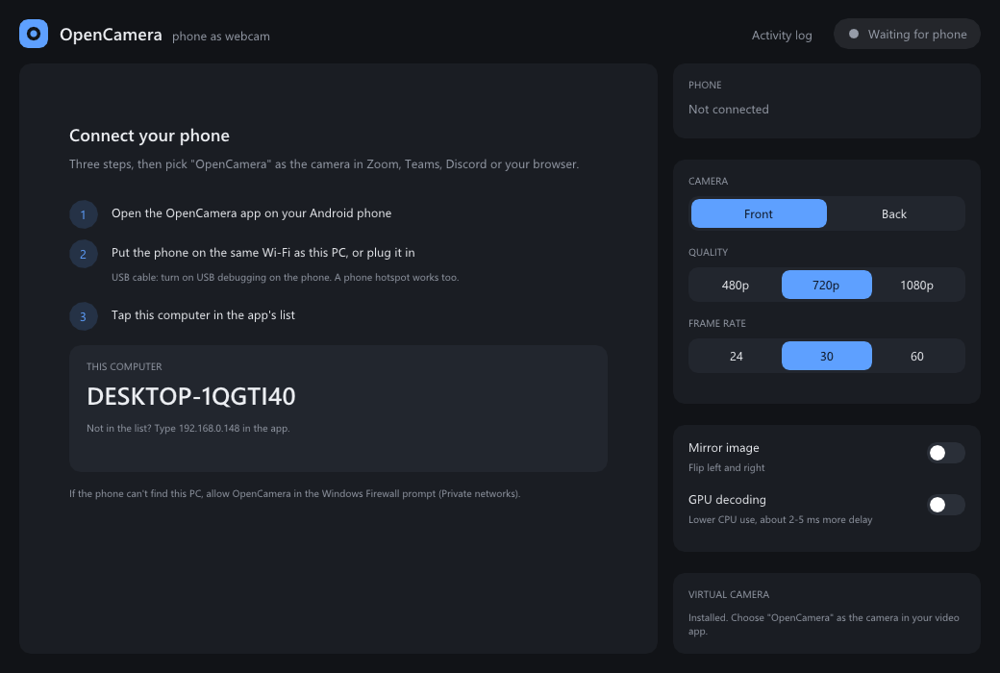
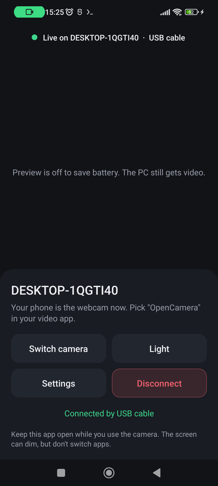
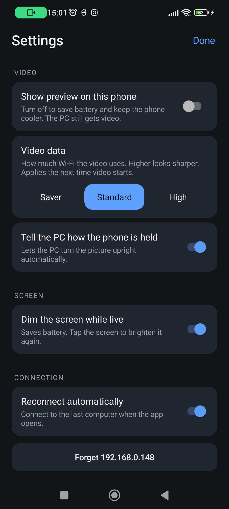
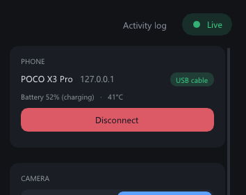

# OpenCamera

Use your Android phone as a webcam on Windows, over Wi-Fi or a USB cable.

This is a reworked version of [OpenCamera](https://github.com/changliu98/OpenCamera), an open-source alternative to DroidCam. Both apps were redesigned, the video path was rebuilt for lower delay, and the PC app gained camera-style manual controls. See [IMPROVEMENTS.md](IMPROVEMENTS.md) for what changed and what was tested.

  

## What it does

- **Phone as webcam:** shows up as a camera called "OpenCamera Z" in Zoom, Teams, Discord, OBS and browsers.
- **Wi-Fi or USB cable:** the phone finds the PC by itself on the same Wi-Fi. Plug in a cable with USB debugging on and it moves to the cable automatically, then back to Wi-Fi if you unplug it. The PC shows which one is in use.
- **Pro controls on the PC:** ISO, shutter, exposure compensation, white balance (presets or Kelvin), manual focus, zoom, exposure lock, the phone's light, stabilisation and anti-flicker. Click the picture to focus there.
- **Monitoring aids:** grid, histogram, zebra (clipped highlights), focus peaking and a level line.
- **Rotation:** rotate in steps, follow how the phone is held, or crop a portrait picture to fill 16:9.
- **Quality:** 480p, 720p or 1080p at the frame rates your phone supports.
- **Phone settings:** turn off the phone's preview to save battery and heat, choose how much data the video uses, dim the screen while live.
- **Readouts:** the PC shows the phone's battery and warns when it gets warm.

  
  
  

## How to use it

You need a Windows 10/11 PC (64-bit) and an Android phone (Android 5 or newer).

1. Install and open OpenCamera on the PC. Click **Install virtual camera** once (Windows asks for permission).
2. Open the OpenCamera app on the phone.
3. Connect them in one of these ways:
   - **Wi-Fi:** put both on the same Wi-Fi, then tap the PC's name in the phone app. A phone hotspot works too. If Windows Firewall asks, allow OpenCamera on private networks.
   - **USB cable:** turn on USB debugging on the phone and plug it in. The PC uses `adb` (from the Android SDK platform-tools, scrcpy, or placed next to OpenCamera) and connects through the cable by itself.
4. Pick **OpenCamera Z** as the camera in your video app.

Keep the phone app open while you use the camera; Android doesn't let apps use the camera in the background.

## Building

See the **Building** section of [IMPROVEMENTS.md](IMPROVEMENTS.md):

- **PC:** Visual Studio 2019 or newer, `Windows/EncomService` (Release x64) and `Windows/EncomCamera` (x64 and Win32).
- **Phone:** `cd Android && gradle assembleDebug`, or open `Android` in Android Studio.

## Compatibility

The virtual camera is a DirectShow filter. The original project reported these results:

## License

GPL-3.0, the same as the original project. See [LICENSE](LICENSE).

## Thanks

This project stands on the work of the original OpenCamera developers: **yukimuon**, **teamclouday** and **Nagato**, with the repository hosted by **changliu98**. They designed the phone-to-PC protocol, the DirectShow virtual camera and the first Windows and Android apps, and released it all as open source so others could build on it. Thank you.

Thanks also to the authors of [libstreaming](https://github.com/fyhertz/libstreaming), [FFmpeg](https://ffmpeg.org/), [Dear ImGui](https://github.com/ocornut/imgui) and [SDL](https://www.libsdl.org/), which this project uses.
